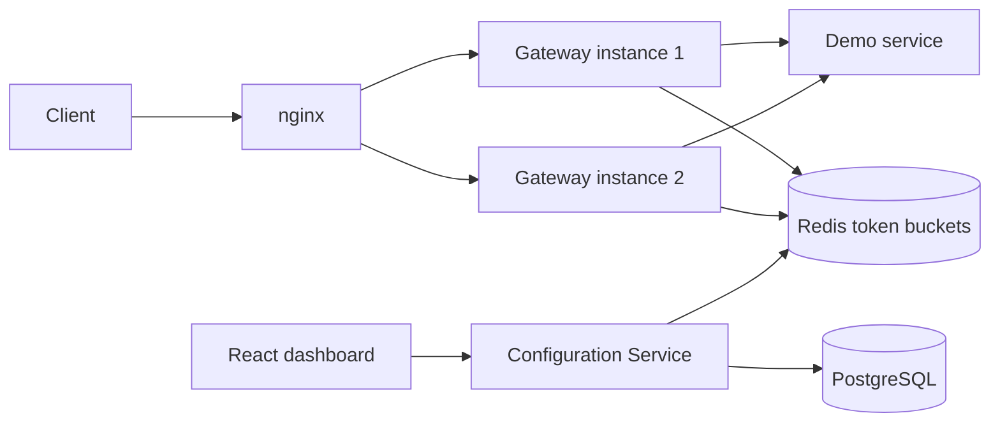

# Distributed Rate Limiter

A learning project for SDE-1 / Software Engineer 1 preparation. It will enforce per-client API rate limits across multiple gateway instances using a **Token Bucket** stored in Redis and evaluated atomically with a Lua script.

**Current status:** Milestone 0 — repository skeleton and local infrastructure. The rate limiter, admin API, dashboard, and deployment are **planned, not implemented**.

| Area | Status |
|---|---|
| Maven multi-module skeleton | Implemented |
| Spring Boot entry points (empty apps) | Implemented |
| PostgreSQL 16 + Redis 7 via Docker Compose | Implemented and verified (see Testing) |
| Token Bucket / Redis Lua | Planned (Milestone 3) |
| Admin API, snapshots, gateway filters | Planned (Milestones 1–6) |
| Security, dashboard, metrics, two-gateway load test, EC2 | Planned (Milestones 7–11) |

---

## Project overview

### What this project does (planned)

API clients will send requests through an API gateway with an `X-API-Key` header. The gateway will identify the client, choose the most specific rate-limit policy for that client’s plan, and ask Redis whether a token is available. Allowed requests are forwarded to a demo backend. Excess requests receive `429 Too Many Requests`.

### Objectives

- Learn backend fundamentals by building a small, realistic distributed system.
- Practice OOP, REST, SQL, concurrency, caching, and system-design trade-offs that SDE-1 interviews expect.
- Keep the architecture simple: three Spring Boot apps, one shared limiter library, PostgreSQL for configuration, Redis for hot state.

### Problems it will solve

- **Unfair or abusive traffic:** one client cannot consume unbounded backend capacity.
- **Inconsistent limits across instances:** two gateways will share one Redis bucket per client and policy, so they cannot each grant a full burst.
- **Race conditions:** Redis runs the read-refill-consume-write steps in one Lua script so two requests cannot both spend the last token.

### Intended use cases

- Server-to-server API clients (not browsers calling the gateway).
- An admin managing plans, policies, clients, and API keys from a dashboard.
- Local development and a later single-host Docker Compose / EC2 demo.

---

## Architecture

**Implemented now:** empty Java modules plus PostgreSQL and Redis on a private Docker network.

**Planned runtime:**



### Component responsibilities

| Component | Role | Status |
|---|---|---|
| **Gateway** | Authenticate API keys, apply Token Bucket, forward to the demo service | Skeleton only |
| **rate-limiter-core** | Redis Lua Token Bucket library used by the gateway | Skeleton only |
| **Configuration Service** | Admin CRUD, PostgreSQL, snapshot API | Skeleton only |
| **snapshot-api** | Shared snapshot records (no Redis / HTTP) | Skeleton only |
| **Demo service** | Tiny in-memory backend behind the gateway | Skeleton only |
| **PostgreSQL 16** | Durable plans, clients, keys, policies | Running locally via Compose |
| **Redis 7** | Token buckets and later metrics | Running locally via Compose |
| **React dashboard** | Admin UI | Placeholder directory |
| **nginx** | TLS, same-origin admin, public `/api/` | Placeholder directory |

### Planned request flow

1. Client calls `GET /api/...` with `X-API-Key`.
2. Gateway matches a route, hashes the key, loads the client from an in-memory snapshot.
3. Gateway picks the most specific policy and calls Redis (`EVALSHA`).
4. If allowed, it forwards the request (API key stripped, `X-Client-Id` set). If not, it returns `429`.

The gateway will **not** query PostgreSQL per request. It will refresh a snapshot from the Configuration Service about every 10 seconds.

### Maven modules

| Module | Depends on | Must not depend on |
|---|---|---|
| `snapshot-api` | — | Spring Web, JPA, Redis |
| `rate-limiter-core` | — (Redis client in Milestone 3) | HTTP, MVC, JPA, `config-service` |
| `config-service` | `snapshot-api` | `rate-limiter-core` |
| `gateway` | `snapshot-api`, `rate-limiter-core` | PostgreSQL / JPA |
| `demo-service` | — | Limiter and config modules |

---

## Technology stack

| Technology | Why we use it |
|---|---|
| **Java 21** | Language you already know; virtual threads later for blocking Redis calls |
| **Maven multi-module** | One repo, one version, clear module boundaries |
| **Spring Boot 3.5.16** | Standard way to build production Java services |
| **Spring Cloud 2025.0.3** | Official release train for Boot 3.5.x ([compatibility table](https://spring.io/projects/spring-cloud)) |
| **Spring Cloud Gateway Server MVC** | Servlet / thread-per-request gateway (`spring-cloud-starter-gateway-server-webmvc`), not the reactive WebFlux gateway |
| **PostgreSQL 16** | Source of truth for configuration |
| **Redis 7** | Shared, atomic limiter state (`TIME` + Lua) |
| **Docker Compose** | One-command local Postgres and Redis |
| **React + Vite** | Future admin UI (Milestone 8) |
| **nginx** | Future TLS and reverse proxy (Milestone 8+) |
| **AWS EC2** | Future single-host deploy (Milestone 11) |

**Intentionally out of scope:** Eureka, Spring Cloud Config Server, Kafka, Kubernetes, Redis Cluster, a separate rate-limiter microservice.

---

## Key features

All of the following are **planned** unless marked implemented.

- Token Bucket rate limiting with lazy refill — *planned*
- Atomic Redis Lua (`EVALSHA`, write on allow only) — *planned*
- Two gateway instances sharing Redis — *planned* (Milestone 10)
- API-key authentication (`X-API-Key`, SHA-256 stored) — *planned*
- Plans and policies in PostgreSQL — *planned*
- Configuration snapshots + `ETag` / `304` — *planned*
- Admin dashboard — *planned*
- Best-effort metrics flushed to Redis — *planned*
- Maven multi-module + Compose infra — **implemented (Milestone 0)**

---

## Algorithm (planned)

Token Bucket, lazy refill:

- Each client+policy has a Redis hash `rl:bucket:<clientId>:<policyId>` with `tokens` and `ts`.
- On a request, a Lua script uses Redis `TIME`, refills `min(capacity, tokens + elapsed × rate)`, and consumes one token if available.
- Redis executes the script atomically (single-threaded), which prevents two gateways from over-admitting.
- Denied requests do not write. Idle keys expire after about one full refill period.

**This Lua script is not in the repository yet.**

---

## API documentation

### Implemented

No public HTTP APIs yet. The three Spring Boot apps are empty entry points:

| Application | Default local port | Endpoints |
|---|---|---|
| `gateway` | 8080 | None implemented |
| `config-service` | 8081 | None implemented |
| `demo-service` | 8082 | None implemented |

### Planned (do not call these yet)

- Gateway public traffic: `/api/**` with `X-API-Key`
- Admin: `/api/v1/admin/plans`, `/clients`, `/api-keys`, policies
- Internal: `GET /internal/v1/snapshot`

---

## Database design (planned)

PostgreSQL tables will be created with Flyway in Milestone 1. **No migrations exist yet.**

| Table | Purpose |
|---|---|
| `plans` | Tiers such as FREE, PRO, ENTERPRISE |
| `clients` | API customers assigned to a plan |
| `api_keys` | SHA-256 hashes and display prefixes; `revoked_at` for soft revoke |
| `rate_limit_policies` | Path, method (`ANY`/`GET`/…), capacity, refill, version |

---

## Configuration

Copy `.env.example` to `.env` and change the passwords.

| Variable | Purpose | Used in Milestone 0 |
|---|---|---|
| `POSTGRES_DB` | Database name | Yes |
| `POSTGRES_USER` | Database user | Yes |
| `POSTGRES_PASSWORD` | Database password | Yes |
| `REDIS_PASSWORD` | Redis `requirepass` | Yes |
| `REDIS_MAXMEMORY` | Redis memory cap (default `256mb`) | Yes |
| `INTERNAL_TOKEN` | Gateway ↔ config-service shared secret | Future |
| `ADMIN_USERNAME` | Dashboard admin | Future |
| `ADMIN_PASSWORD_BCRYPT` | Bcrypt hash of admin password | Future |
| `GATEWAY_INSTANCE_ID` | Distinguishes `gw-1` / `gw-2` | Future |

Never commit `.env`. Compose interpolates variables from `--env-file`; it does not hardcode secrets.

---

## Local setup

### Prerequisites

- Java 21
- Maven Wrapper is committed (`./mvnw`); a local Maven install is optional
- Docker Desktop (or another Docker Engine + Compose v2)
- Git
- Node.js — **future** (dashboard, Milestone 8)

If `java` is not on your `PATH`, set `JAVA_HOME` to a JDK 21 installation.

### Environment file

```bash
cp .env.example .env
# Edit POSTGRES_PASSWORD and REDIS_PASSWORD in .env
```

---

## Execution instructions

Commands below assume the **repository root**.

### Start PostgreSQL and Redis (IDE-accessible ports)

This uses the **override** file so you can reach `localhost:5432` and `localhost:6379` from IntelliJ / DataGrip / `redis-cli`.

```bash
docker compose --env-file .env \
  -f infrastructure/docker/docker-compose.yml \
  -f infrastructure/docker/docker-compose.infra.yml \
  up -d
```

### Start infrastructure without publishing ports

Use this when you only want containers on the Docker network (full-stack style):

```bash
docker compose --env-file .env \
  -f infrastructure/docker/docker-compose.yml \
  up -d
```

### Validate Compose files

```bash
docker compose --env-file .env \
  -f infrastructure/docker/docker-compose.yml \
  config

docker compose --env-file .env \
  -f infrastructure/docker/docker-compose.yml \
  -f infrastructure/docker/docker-compose.infra.yml \
  config
```

### Stop infrastructure

```bash
docker compose --env-file .env \
  -f infrastructure/docker/docker-compose.yml \
  -f infrastructure/docker/docker-compose.infra.yml \
  down
```

Add `-v` only if you also want to delete the Postgres volume.

### Build and unit-test (no Docker required)

```bash
./mvnw -version
./mvnw test
```

`./mvnw verify` will later run Testcontainers (`*IT`). That is **not** set up in Milestone 0.

### Run a Spring Boot app from the IDE (optional)

Start infra with the override first. The apps do not connect to Postgres or Redis yet; they only listen on the ports above.

---

## Testing

### Current tests (Milestone 0)

Each executable module has a `contextLoads` test (`@SpringBootTest`). Library modules have no tests yet.

Verified on 2026-11-05 with `./mvnw test` (Java 21.0.13.0.3, Maven 3.10.0):

| Module | Tests | Result |
|---|---|---|
| snapshot-api | 0 | SUCCESS |
| rate-limiter-core | 0 | SUCCESS |
| config-service | 1 | SUCCESS |
| gateway | 1 | SUCCESS |
| demo-service | 1 | SUCCESS |

Reactor: **BUILD SUCCESS**. Details are also in [PROJECT_PLAN.md](PROJECT_PLAN.md).

### Future strategy (approved)

- **Surefire / `mvn test`:** unit tests (matching, validation). No Docker.
- **Failsafe / `mvn verify`:** Testcontainers Redis 7 and PostgreSQL 16 (`*IT`).
- **Lua is the only production Token Bucket math.** Concurrent `CountDownLatch` tests against real Redis.
- **Compose smoke suite** and **k6** under `load-tests/` in later milestones.
- Two-gateway over-admission test is required before claiming “distributed” (Milestone 10).

---

## Deployment

**Pending.** Milestone 11 covers TLS at nginx and AWS EC2. There are no deploy scripts or cloud resources in this milestone.

---

## Project plan

See [PROJECT_PLAN.md](PROJECT_PLAN.md) for milestones, dependencies, and interview checkpoints.

---

## License

Educational / personal project. Add a license file if you publish the repository.
